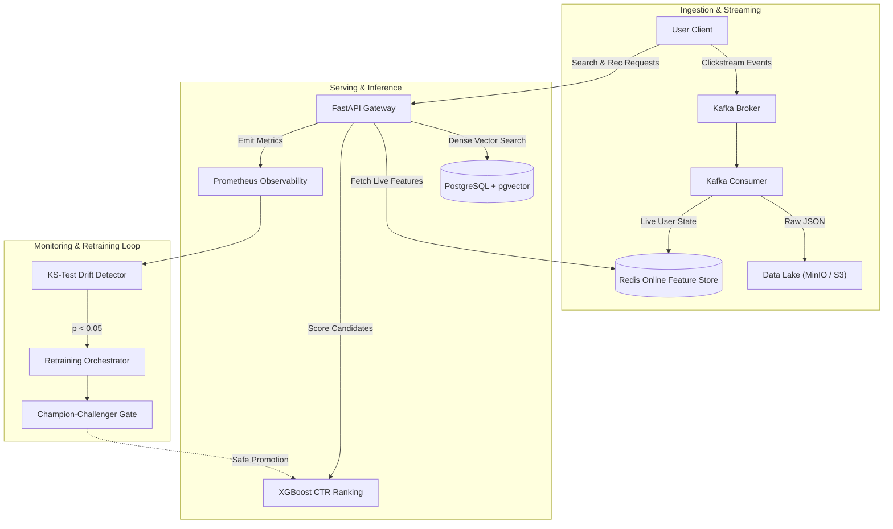

# Real-Time E-Commerce Recommendation & Search Engine
### *The Showcase Blueprint for AI System Design (AISD)*

[](https://www.python.org/)
[](https://fastapi.tiangolo.com/)
[](https://github.com/pgvector/pgvector)
[](https://redis.io/)
[](https://kafka.apache.org/)
[](https://www.docker.com/)

---

## 📌 Project Overview
This repository contains the complete end-to-end implementation of a **Real-Time E-Commerce Recommendation and Semantic Search Engine**, built specifically to showcase modern, production-grade **AI System Design (AISD)**.

Unlike typical tutorial ML projects that train static models on static CSV files in Jupyter notebooks, this system treats the machine learning model as a replaceable component inside a distributed, low-latency, event-driven data and serving architecture.

---

## 🏛️ System Architecture



---


## 📁 Repository Directory Structure

```
AI System Design/
├── AI System Design - A showcase of complete AI system.md   # Master Blueprint & Syllabus Spec
├── README.md                                                 # Project documentation & quickstart
├── Dockerfile                                                # Production Docker image build
├── docker-compose.yml                                        # Multi-container orchestration stack
├── requirements.txt                                          # Python dependencies
├── pyproject.toml                                            # Project configuration & test settings
├── Makefile                                                  # Developer shortcuts
│
├── config/                                                   # Environment & observability settings
│   ├── prometheus.yml                                        # Scrape targets for Prometheus
│   └── settings.py                                           # Centralized Pydantic BaseSettings
│
├── docs/                                                     # Technical design & specs
│   ├── architecture.md                                       # High-level architecture specification
│   ├── system_requirements_nfr.md                            # SLAs, NFRs, and latency budgets
│   └── components_mapping.md                                 # System components & capabilities matrix
│
├── scripts/                                                  # Database & simulation scripts
│   ├── init_warehouse.sql                                    # PostgreSQL + pgvector schema init
│   ├── seed_products.py                                      # Synthetic product catalog generator
│   ├── run_simulation.py                                     # End-to-end closed loop demo runner
│   └── load_test_locust.py                                   # Locust load test benchmark script
│
├── data/                                                     # Data stores (gitignored)
│   ├── raw/                                                  # Raw JSON clickstream events (Lake)
│   ├── processed/                                            # Processed Parquet datasets
│   └── embeddings/                                           # Vector index checkpoints
│
├── app/                                                      # FastAPI Serving Layer
│   ├── __init__.py
│   ├── main.py                                               # FastAPI app initialization & lifespan
│   ├── api/                                                  # Route handlers
│   │   ├── health.py                                         # /health & /metrics
│   │   ├── search.py                                         # /search (Dense vector retrieval)
│   │   ├── recommend.py                                      # /recommend & /predict (CTR ranking)
│   │   └── feedback.py                                       # /feedback (User telemetry sink)
│   ├── schemas/                                              # Pydantic data validation contracts
│   └── core/                                                 # DB pools, Redis client, Prometheus metrics
│
├── src/                                                      # Core Data, ML & Monitoring Engine
│   ├── data_engineering/                                     # Streaming Kafka producer/consumer & batch ETL
│   ├── feature_store/                                        # Dual feature store & transformation pipeline
│   ├── modeling/                                             # CTR training, embeddings, time-series split
│   └── monitoring/                                           # KS-test drift detector & retraining loop
│
└── tests/                                                    # Comprehensive Test Suite
    ├── unit/                                                 # Unit tests (drift, features, models)
    ├── integration/                                          # Integration tests (API, feature store, Kafka)
    └── performance/                                          # P99 latency SLA (<100ms) benchmark tests
```

---

## ⚡ Quickstart Guide

### 1. Run Tests Locally
```bash
# Run all unit and integration tests
pytest tests/

# Run performance SLA tests (< 100ms P99 latency verification)
pytest tests/performance/test_latency_sla.py
```

### 2. Start Multi-Container Stack (Docker Compose)
```bash
# Build and launch all 5 services
docker compose up -d --build

# Check running services
docker compose ps
```

Services exposed:
- **FastAPI Application**: [http://localhost:8000/docs](http://localhost:8000/docs)
- **Prometheus Dashboard**: [http://localhost:9090](http://localhost:9090)
- **PostgreSQL / pgvector**: `localhost:5432`
- **Redis Online Store**: `localhost:6379`
- **Apache Kafka Broker**: `localhost:29092`

### 3. Run End-to-End Simulation
Test the complete self-healing system loop (Stream Ingestion $\to$ Feature Store $\to$ Drift Detection $\to$ Retraining Trigger):
```bash
python3 scripts/run_simulation.py
```


### **What the Project Omits from AI System Design that will be Implemented in the future (The GenAI / LLM Gap)**

While the syllabus provides a complete foundation for **predictive ML and data platform engineering**, it skips the newer **Generative AI &amp; Foundation Model Engineering stack** covered in Chip Huyen’s 2025 book *AI Engineering* and ByteByteGo’s *Generative AI System Design Interview*:

* **Foundation Model Adaptation:** The project not yet explicitly cover **Prompt Engineering**, **RAG (Retrieval-Augmented Generation)**, **Vector Databases &amp; HNSW indexing**, or **LoRA/PEFT Finetuning**.
* **LLM Serving &amp; Inference Optimizations:** It omits modern LLM serving bottlenecks, such as **autoregressive decoding**, **KV Caching**, **Quantization (INT8/FP4)**, and **Speculative Decoding**.
* **Agentic Workflows &amp; Guardrails:** It does not cover multi-agent orchestration, tool calling, or output guardrails.
