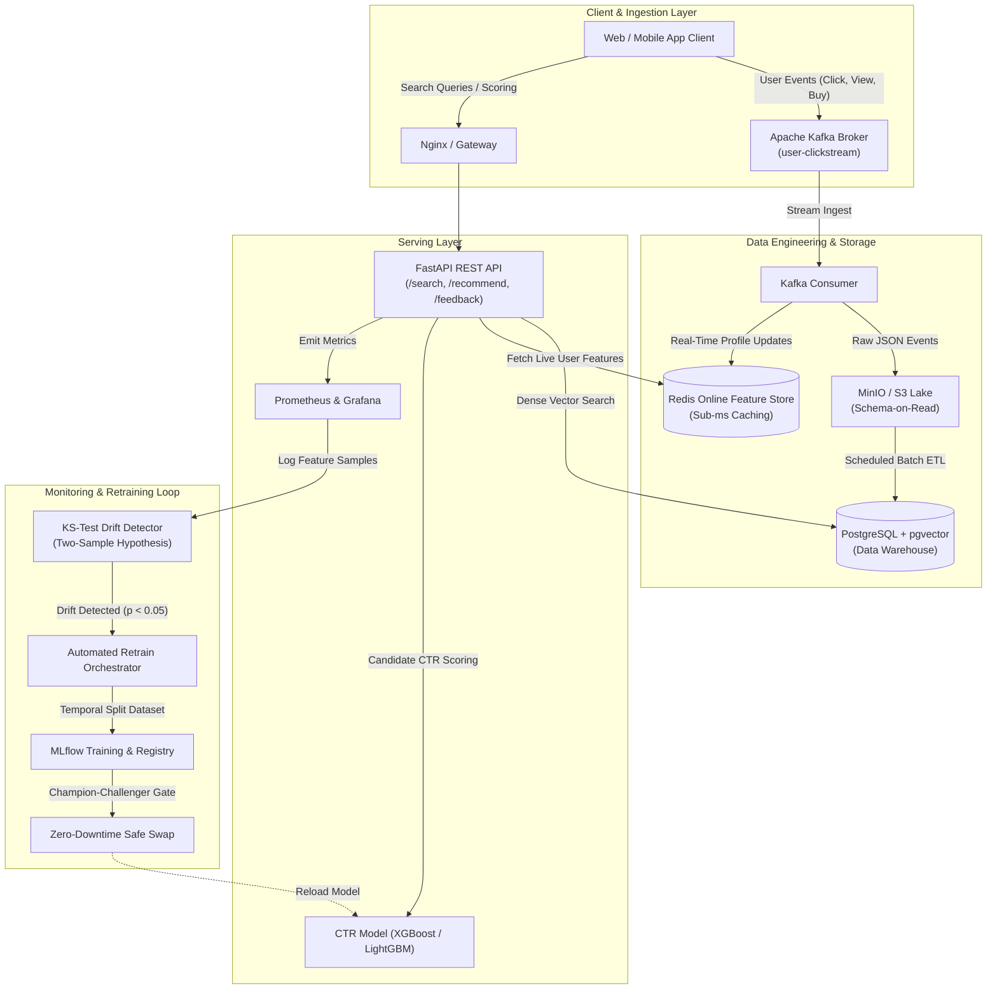

# System Architecture: Real-Time E-Commerce Recommendation & Search Engine

## Overview
This document defines the high-level system architecture for the Real-Time E-Commerce Recommendation & Search Engine.

---

## 1. High-Level Block Diagram

---

## 2. Component Responsibility Matrix

| Component | Responsibility | Technology Stack |
| :--- | :--- | :--- |
| **Kafka Event Broker** | Ingest high-throughput user interaction clickstreams | Apache Kafka / Confluent |
| **Data Lake** | Store immutable, raw JSON event payloads | MinIO / S3 (Schema-on-Read) |
| **Data Warehouse** | Structured relational tables, historical interactions, vector index | PostgreSQL 16 + `pgvector` |
| **Online Feature Store** | Sub-millisecond user feature retrieval during inference | Redis 7 |
| **Offline Feature Store** | Historical feature aggregations for training datasets | Parquet / PostgreSQL |
| **Inference API** | Serve `/search`, `/recommend`, `/feedback` endpoints | FastAPI + Uvicorn + Pydantic |
| **Model Runtime** | Real-time CTR scoring and sentence embedding generation | XGBoost + SentenceTransformers |
| **Drift Monitoring** | Detect covariate shift on live serving distributions | Scipy KS-Test + Prometheus |
| **Retraining Loop** | Closed-loop retraining, validation gating, model reload | MLflow + Automated Trigger |

---

## 3. Data Flow Pathways

### A. Online Inference Path (Sub-100ms P99 SLA)
1. User requests recommendations: `POST /recommend { user_uuid, candidate_ids }`.
2. FastAPI fetches latest user behavioral features (last 5 categories, click rate) from **Redis** in `< 2ms`.
3. Candidate item features are combined with user features into feature vectors.
4. The XGBoost model calculates click probabilities and ranks candidates.
5. Response returned to client in `< 50ms`.

### B. Semantic Vector Search Path
1. User enters query: `GET /search?query="waterproof running shoes"`.
2. Query text converted into a 384-dimensional dense embedding via `SentenceTransformers`.
3. Cosine similarity query executed against PostgreSQL `products` table using the HNSW index.
4. Top $K$ closest semantic matches returned.

### C. Self-Healing Closed-Loop Path
1. Live serving feature distributions are accumulated in memory or scraped by Prometheus.
2. The `FeatureDriftDetector` executes a two-sample Kolmogorov-Smirnov test against baseline training data.
3. If $p < 0.05$ on critical features, `retrain_trigger.py` initiates a fresh training pipeline.
4. The newly trained challenger model must beat the champion on validation AUC before promotion.
